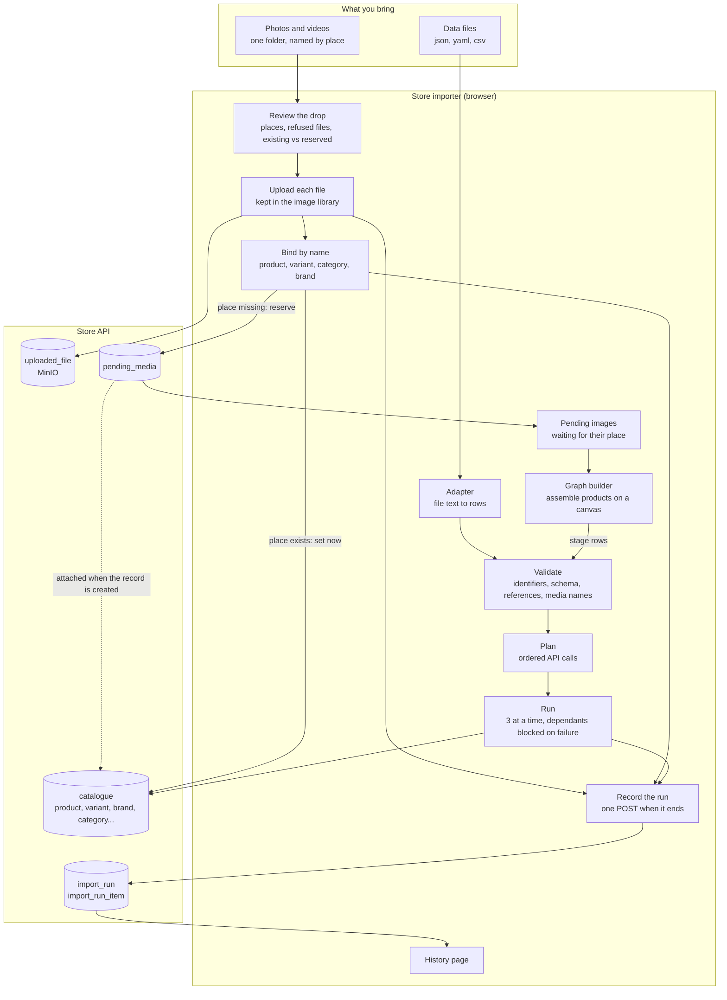
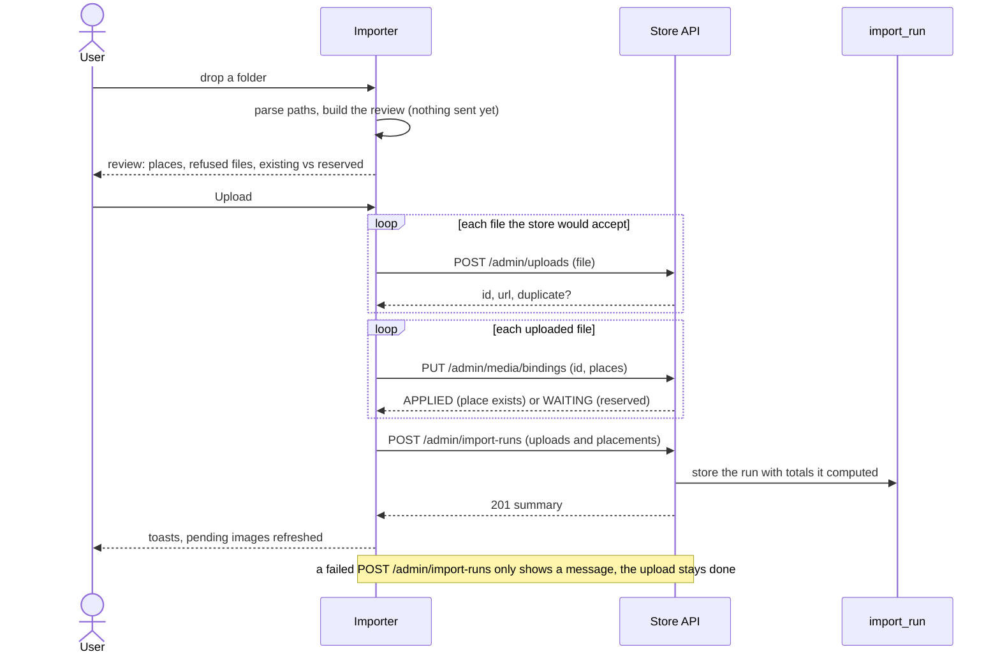
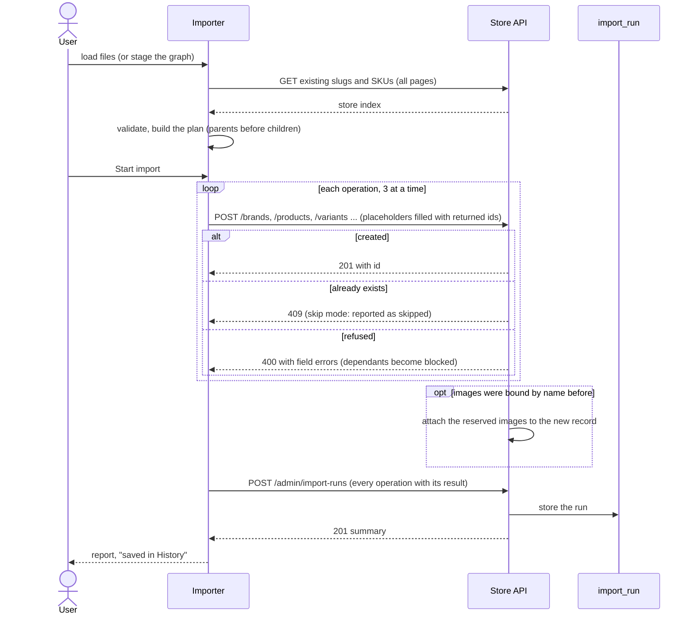
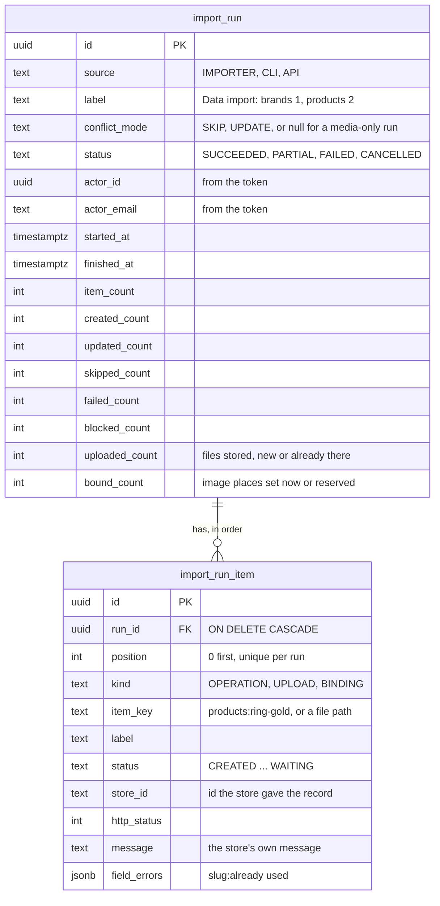
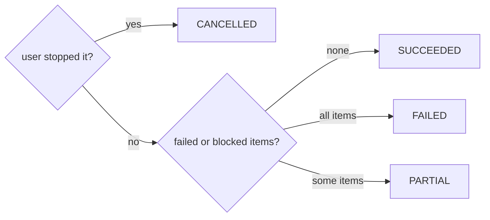

# Store importer

Load products and catalogue elements into the store from **JSON, YAML or CSV** files instead of typing them in the admin.

```
file (json | yaml | csv) → adapter → JSON rows → validation → upload to the store API
```

* Every row has an identifier (`slug`, `sku` or `key`); rows refer to each other with it.
* Images and videos are uploaded once in an image uploader; the tool keeps a library (file name → store URL) and data files
  refer to them as `media:<fileName>`.
* **Media Library & Folder Importer**: Supports directory structure upload with wildcard multi-entity bindings (`[slug-a, slug-b]`), individual path-bound orders, aspect ratio classification (`1x1`, `4x5`, `16x9` folders), and store binding synchronization (`PUT /api/v1/admin/media/bindings`), and a downloadable empty folder template built from your loaded files (fill it with photos, drop it back); see [docs/MEDIA_LIBRARY.md](docs/MEDIA_LIBRARY.md).
* Ready-made templates with documentation for each resource live in [`templates/`](templates): media, tags, brands,
  categories, collections, products, variants (no media file: images go through the uploader).

## How it works

The tool has no server of its own: everything it knows is sent to the store's REST API, and the store keeps the
[history](#import-history) of what was sent. Two ways in, which meet in the store:



### Dropping a folder

Photos can go first: a place that does not exist yet is *reserved* and filled when it is created.



### Importing data



## Import history

Every data import and every media drop is kept by the store, so *who imported what, when, and what went wrong* survives a
page reload and is shared between staff. The **History** page of the tool lists them (filter by source and result,
open a run to see each call, file and image placement, download it as JSON).

* The tool sends **one record when a run ends**, not while it runs. If the browser is closed mid-run, that run is not recorded.
* The store computes the totals and the result from the items, never from what the client says about itself.
* History is **append only**: there is no update and no delete endpoint.
* A failed save never undoes an import: the tool shows a message and the report stays downloadable.
* The CLI records its `media drop` runs the same way (source `CLI`).



| Item kind | One row per | Statuses |
|---|---|---|
| `OPERATION` | API call of the plan | `CREATED` `UPDATED` `SKIPPED` `FAILED` `BLOCKED` `CANCELLED` (never reached: the user stopped the run) |
| `UPLOAD` | file sent to the store | `UPLOADED` (new) `DUPLICATE` (same bytes already stored) `FAILED` |
| `BINDING` | image placement | `APPLIED` (place exists, image set) `WAITING` (reserved) `FAILED` |

The result of a run: `CANCELLED` if the user stopped it; otherwise `SUCCEEDED` when nothing failed or was blocked, `FAILED`
when everything did, `PARTIAL` in between. A `SKIPPED` record counts as fine (it was already there).



API (staff and admins, `/api/v1/admin/import-runs`):

| Call | Does |
|---|---|
| `POST /` | record a finished run `{source, label, conflictMode, startedAt, finishedAt, cancelled, items[]}` (1 to 5000 items), answers `201` with the summary |
| `GET /?source=&status=&actorEmail=&page=&size=` | runs, newest first |
| `GET /{id}` | one run with all its items, in order |

## Status
The entire pipeline (reading, templates, validation, media library & folder upload, store planning, execution, and visual Graph Builder canvas) is implemented and tested.
See [docs/TASKS.md](docs/TASKS.md). Design and rules: [docs/ARCHITECTURE.md](docs/ARCHITECTURE.md) and [docs/MEDIA_LIBRARY.md](docs/MEDIA_LIBRARY.md).

## Run
```bash
npm install
npm run dev      # http://localhost:5174, /api proxied to http://localhost:8080 (STORE_API_URL to change)
npm test         # adapters, validation, media folder parser, every shipped example
npm run build
```

## Look
Colours, type and radii are the store's shared design tokens (`accessories-store-system/design-tokens`), the same as the admin; see its README.
The importer carries its own **copy** in [`src/styles/tokens.css`](src/styles/tokens.css), so `npm install` and `npm run build` work wherever it is
cloned (next to the store repository, or inside it as a submodule). After the tokens change in the store repo: `npm run tokens:sync` here
(it finds the store repo, or use `DESIGN_TOKENS_DIR`), and `npm run tokens:check` tells whether the copy is out of date.

## Layout
```
docs/MEDIA_LIBRARY.md   media library folder structure upload & binding guide
templates/<resource>/   README.md (the column documentation) + example .json .yaml .csv
src/core/types.ts       the contracts between stages
src/adapters/           json, yaml, csv  →  ImportDocument
src/templates/          zod schema per resource, shared field helpers, registry
src/validate/           identifiers, schema, references, image names
src/upload/             API client + image library + media folder parser + plan + run
src/history/            what a run records: items, status, API client, formatting (History page)
src/graph/              graph builder model, bundler & presets
src/ui/                 5-step import screen + workflow graph canvas
```
